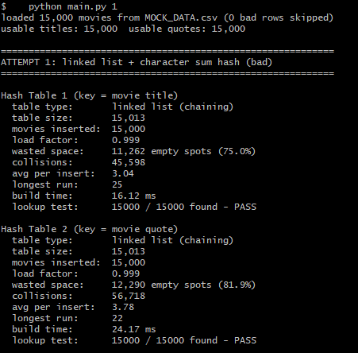
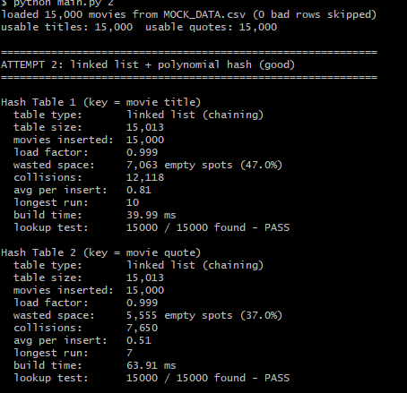
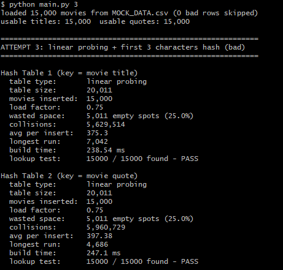
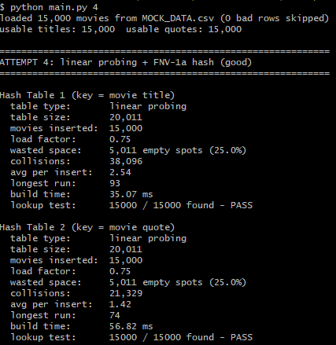
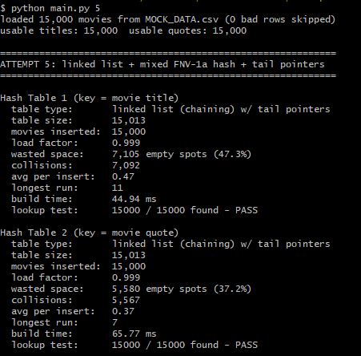

# COS 226 - Hash Something Out

Two hash tables for 15,000 fake movies from `MOCK_DATA.csv`. Table 1 uses the movie title as the key and table 2 uses the quote. Each commit is one attempt at a different hash table setup, and the program prints wasted space, collisions, and build time for both tables.

## How to run

```
python main.py      # every attempt
python main.py 2    # just attempt 2
```

(`python3` on Mac.) `MOCK_DATA.csv` needs to be in the same folder. No extra packages needed.

## Files

* `main.py` - loads the csv, builds the tables for each attempt, prints the stats
* `hash_tables.py` - the hash table classes
* `hash_functions.py` - every hash function I tried, with comments on each one

## How I measured things

* **Collisions:** every time I look at a spot and something's already there. In a linked list, walking past 4 nodes to get to the end counts as 4.
* **Wasted space:** empty buckets/slots left after all 15,000 movies are in.
* **Build time:** only the time to insert everything, not reading the file. It changes a little every run, but collisions and wasted space are the same every time.
* After building, every movie gets looked up again to make sure the table actually works (the "lookup test" line).

## Stuff I noticed in the data

* Only 11,309 of the 15,000 titles are unique, so a lot of titles repeat. I keep every movie instead of overwriting duplicates.
* About 3,500 titles have commas in them, so a plain `split(",")` breaks. I used the `csv` module instead.
* One "quote" is around 49,000 characters long. It doesn't break anything, it just takes longer to hash.

## Results

Linked list tables have 15,013 buckets.
Linear probing tables have 20,011 slots (about 75% full).

| # | Attempt | Table | Collisions | Wasted space | Longest chain/probe | Build time |
|---|---|---|---:|---:|---:|---:|
| 1 | Linked list + character sum (bad) | Title | 45,598 | 11,262 (75.0%) | 25 | 16.12 ms |
| 1 | | Quote | 56,718 | 12,290 (81.9%) | 22 | 24.17 ms |
| 2 | Linked list + polynomial (good) | Title | 12,118 | 7,063 (47.0%) | 10 | 39.99 ms |
| 2 | | Quote | 7,650 | 5,555 (37.0%) | 7 | 63.91 ms |
| 3 | Linear probing + first 3 chars (bad) | Title | 5,629,514 | 5,011 (25.0%) | 7,042 | 238.54 ms |
| 3 | | Quote | 5,960,729 | 5,011 (25.0%) | 4,686 | 247.1 ms |
| 4 | Linear probing + FNV-1a (good) | Title | 38,096 | 5,011 (25.0%) | 93 | 35.07 ms |
| 4 | | Quote | 21,329 | 5,011 (25.0%) | 74 | 56.82 ms |
| 5 | Linked list + mixed FNV-1a + tail pointers | Title | 7,092 | 7,105 (47.3%) | 11 | 44.94 ms |
| 5 | | Quote | 5,567 | 5,580 (37.2%) | 7 | 65.77 ms |

## Screenshots







## Reflection

### Attempt 1: linked list + character sum

I started with a bad hash on purpose so I'd have something to compare against. Adding up the characters gives really small numbers (most titles land around 1,500), so most of the table never gets used. 75% of the title buckets and 82% of the quote buckets were empty, and the longest chain was 25. It was still fast though, since adding numbers is about as cheap as a hash gets.

### Attempt 2: linked list + polynomial hash

Same table, but the hash multiplies by 31 before adding each character, so where a letter is actually matters. This cut collisions by about 73% for titles and 87% for quotes. There are still around 40% empty buckets, but from what I read that's normal for chaining when you have about as many buckets as keys, even with a really good hash. Titles had more collisions than quotes because duplicate titles always end up in the same bucket no matter what. It was a little slower to build since there's more math per character.

### Attempt 3: linear probing + first 3 characters

I switched to linear probing and tried a different kind of bad hash that only looks at the first 3 letters. Wasted space dropped to 25% because I sized the table myself, but collisions went over 5.6 million. Hundreds of quotes start with the same few letters ("Pro", "Syn", etc.), so they all want the same spot, spill into the next ones, and form huge clusters. One insert had to step over 7,042 full slots. It was also by far the slowest, about 240 ms per table when everything else was under 70 ms.

### Attempt 4: linear probing + FNV-1a

Same table as attempt 3 with a good hash. Collisions dropped from millions to 38,096 for titles and 21,329 for quotes, and the build time went back to normal. It still had about 3 times more collisions than attempt 2, because with linear probing a taken spot pushes you into the next spot, and those small clusters add up. The upside is it only wastes 25% of the space.

### Attempt 5: improving the best one

Attempt 2 had the fewest collisions, so I built on that. I changed the hash to FNV-1a plus an extra bit-mixing step, and gave each bucket a pointer to the end of its list so inserting doesn't have to walk the whole chain. Collisions went down to 7,092 for titles and 5,567 for quotes, the best of all five.

To be honest, the new hash alone didn't really help. I tested it without the tail pointers and it was within about 1.5% of attempt 2, basically the same. The tail pointers are what made the difference, since now a full bucket only costs 1 collision instead of 1 per node. It costs a bit more memory and doesn't make lookups any faster.

## Final reflection

The hash function mattered way more than anything else. Swapping a bad hash for a good one cut collisions by 73 to 87% for the linked list and over 99% for linear probing. Both bad hashes failed for the same reason: they could only make a small number of different values, so keys piled into a small part of the table.

The table type decided how much a bad hash hurt. The linked list handled the bad hash okay. Collisions went up, but it stayed fast. Linear probing completely fell apart with a bad hash because the clusters kept growing and merging. With a good hash both worked fine, so there was a trade-off. The linked list (attempt 5) had the fewest collisions, and linear probing (attempt 4) wasted the least space. I couldn't get both in one attempt.

Build time mostly depended on how much math the hash does, not on collisions. The cheapest hash was the fastest even with the most collisions. The only time collisions really showed up in the time was attempt 3. Duplicate titles also made the title table worse than the quote table in every attempt, so some collisions come from the data itself no matter which hash you use.

If I kept going, I'd store each unique title once with a list of all the movies that share it. That would get rid of the duplicate-title collisions and let the title table be smaller.
